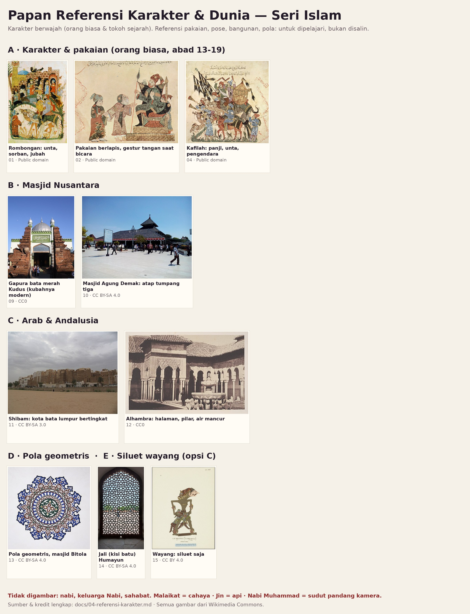

# Referensi karakter dan dunia: seri Islam

Papan ini adalah pegangan visual untuk `cartoon-3d-short`: pakaian, pose, bangunan, dan pola. Gunanya untuk dipelajari, bukan untuk disalin ke dalam video. Bentuk dan warnanya digambar ulang dengan gaya seri sendiri (kartu karakter bergaris tinta, dunia 3D dicat).

## Aturan yang berlaku
- Wajah boleh untuk orang biasa dan tokoh sejarah yang bukan nabi, bukan keluarga Nabi, dan bukan sahabat.
- Malaikat hanya berupa cahaya. Jin dan Iblis hanya berupa api.
- Nabi Muhammad ﷺ hadir hanya sebagai sudut pandang kamera. Sahabat hadir hanya lewat jejak.
- Penampilan tokoh mengikuti rujukan sejarah: pakaian, daerah, dan zamannya.

## Cara memakai tiap bagian
- **A · Karakter dan pakaian:** ilustrasi Maqamat al-Hariri karya al-Wasiti (Baghdad, 1237 M), salah satu gambar tertua tentang orang Arab Muslim biasa. Ambil lapisan jubah, bentuk sorban, sandal, gestur tangan, unta, dan pelana. Jangan mengambil adegan atau ceritanya.
- **B · Masjid Nusantara:** bata merah tanpa plester, atap tumpang tiga, dan serambi. Kubah di foto Kudus adalah tambahan modern, jadi jangan dipakai untuk adegan sejarah.
- **C · Arab dan Andalusia:** Shibam untuk kota bata lumpur bertingkat. Alhambra untuk halaman berpilar ramping dan air mancur.
- **D · Pola:** acuan bentuk saja. Pola di video dibuat sendiri dengan kode di `paint.ts` (bintang 8 dan 12 dari grid lingkaran), sehingga tidak ada urusan lisensi.
- **E · Wayang:** hanya untuk opsi gaya siluet. Tokohnya (Aswattama) berasal dari Mahabharata, jadi jangan dipakai sebagai karakter.

Sengaja tidak dimasukkan: dua ilustrasi Maqamat yang lain (adegan persalinan di istana, dan kemungkinan adegan kedai minum), foto interior Demak (banyak unsur modern dan tidak menunjukkan soko guru kayu), serta dua lukisan Utsmani dan satu foto Menara Kudus yang gagal diunduh karena dibatasi Wikimedia.

## Lisensi dan kredit
Gambar berlisensi CC BY dan CC BY-SA wajib dikredit sesuai tabel di bawah bila ikut tayang. Rencananya gambar ini tidak ikut tayang, hanya dipakai sebagai referensi. Gambar Public domain dan CC0 bebas dipakai.

| File | Judul di Commons | Pembuat | Lisensi | Halaman sumber |
|---|---|---|---|---|
| `referensi/01-maqamat-desa.jpg` | Al-Wasiti-Discussion near a village.jpg | Yaḥyā ibn Maḥmūd al-Wāsiṭī (1237 M) | Public domain | https://commons.wikimedia.org/wiki/File:Al-Wasiti-Discussion_near_a_village.jpg |
| `referensi/02-maqamat-001.jpg` | Yahyâ ibn Mahmûd al-Wâsitî 001.jpg | al-Wâsitî, Yahyâ ibn Mahmûd | Public domain | https://commons.wikimedia.org/wiki/File:Yahy%C3%A2_ibn_Mahm%C3%BBd_al-W%C3%A2sit%C3%AE_001.jpg |
| `referensi/04-maqamat-005.jpg` | Yahyâ ibn Mahmûd al-Wâsitî 005.jpg | Yahya ibn Mahmud al-Wasiti | Public domain | https://commons.wikimedia.org/wiki/File:Yahy%C3%A2_ibn_Mahm%C3%BBd_al-W%C3%A2sit%C3%AE_005.jpg |
| `referensi/09-menara-kudus-depan.jpg` | Masjid Menara Kudus Tampak Depan.jpg | PL09Puryono | CC0 | https://commons.wikimedia.org/wiki/File:Masjid_Menara_Kudus_Tampak_Depan.jpg |
| `referensi/10-demak.jpg` | Masjid Agung Demak.jpg | Hastosuprayogo | CC BY-SA 4.0 | https://commons.wikimedia.org/wiki/File:Masjid_Agung_Demak.jpg |
| `referensi/11-shibam.jpg` | Shibam the mud brick city.JPG | Aneta Ribarska | CC BY-SA 3.0 | https://commons.wikimedia.org/wiki/File:Shibam_the_mud_brick_city.JPG |
| `referensi/12-alhambra-met.jpg` | The Court of Lions in the Alhambra, Spain MET DP209232.jpg | John Gregory Crace | CC0 | https://commons.wikimedia.org/wiki/File:The_Court_of_Lions_in_the_Alhambra,_Spain_MET_DP209232.jpg |
| `referensi/13-pola-bitola.jpg` | Islamic geometric patterns (Aydar kadi mosque, Bitola, Macedonia).jpg | Petar Milošević | CC BY-SA 4.0 | https://commons.wikimedia.org/wiki/File:Islamic_geometric_patterns_(Aydar_kadi_mosque,_Bitola,_Macedonia).jpg |
| `referensi/14-jali-humayun.jpg` | Humayun Tomb jali Islamic geometric pattern.jpg | Hu741f4 | CC BY-SA 4.0 | https://commons.wikimedia.org/wiki/File:Humayun_Tomb_jali_Islamic_geometric_pattern.jpg |
| `referensi/15-wayang-aswattama.jpg` | Aswattama, KITLV 36C106.tiff | Soelardi, Raden. | CC BY 4.0 | https://commons.wikimedia.org/wiki/File:Aswattama,_KITLV_36C106.tiff |

## Sumber lain (belum diunduh, dibuka langsung di browser)
- Open Peeps (CC0), pose dan gestur: https://openpeeps.com
- Quaternius Universal Base Characters (CC0), proporsi tubuh 3D: https://quaternius.com/packs/universalbasecharacters.html
- KayKit Adventurers (CC0), siklus jalan: https://godotengine.org/asset-library/asset/2129
- The Met Open Access dan Smithsonian Open Access (CC0 untuk karya domain publik): tekstil, kaligrafi, dan miniatur Islam. Hindari miniatur yang menggambarkan Nabi ﷺ.
- Poly Haven (CC0): tekstur pasir, batu, dan kayu.
