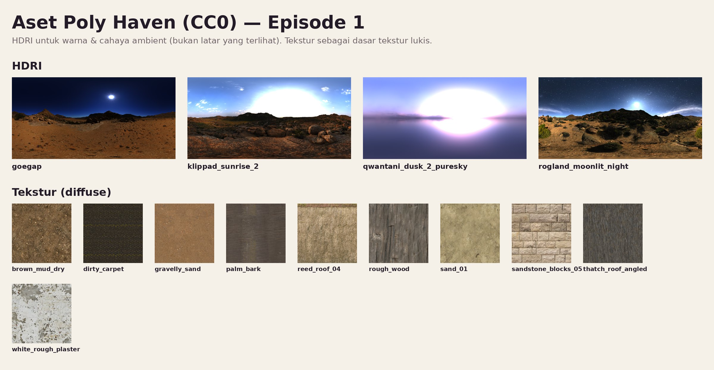

# Aset 3D, tekstur, dan HDRI: Episode 1

Semua aset di sini berlisensi **CC0** (bebas dipakai, termasuk untuk channel yang dimonetisasi, tanpa wajib kredit). Semuanya disimpan di `public/ep01/`, jadi bisa dipanggil dengan `staticFile("ep01/...")` di Remotion.

| Sumber | Lisensi | Isi | Di repo? |
|---|---|---|---|
| [Poly Haven](https://polyhaven.com) | CC0 | 4 HDRI, 9 tekstur, 9 model | Tidak (±70 MB). Unduh ulang dengan `tools/fetch_ep01_assets.sh` |
| Kenney Nature Kit 2.1 (diambil dari salinan di GitHub `BastiaanOlij/godot-vr-weapons`) | CC0, `public/ep01/kenney/License.txt` | 27 model low-poly | Ya (344 KB) |
| [KayKit City Builder Bits 1.0](https://github.com/KayKit-Game-Assets/KayKit-City-Builder-Bits-1.0) | CC0, `public/ep01/kaykit-city/LICENSE.txt` | 8 gedung, lampu jalan, bangku, jalan | Ya (736 KB) |

## Aset per adegan

| # | Adegan | Model 3D | Tekstur | HDRI (cahaya) |
|---|---|---|---|---|
| 1 | Kaki penggembala di pasir → gedung menembus awan | Kenney `rock_*`, `stone_*`, `plant_bushSmall`; Poly Haven `dry_branches_medium_01`, `boulder_01`; KayKit `building_*` | `sand_01`, `gravelly_sand` | `goegap` (siang gurun) |
| 2 | Masjid Nabawi awal dari luar, deretan sandal | Dinding dan tiang **dibangun sendiri** di `build.ts` (lihat catatan). Kenney `tree_palm*` di halaman, `pot_large` | `brown_mud_dry` (dinding bata lumpur), `palm_bark` (tiang batang kurma), `thatch_roof_angled` / `reed_roof_04` (atap pelepah) | `goegap` |
| 3-4, 7 | POV di dalam masjid, cahaya Jibril | Poly Haven `jug_01`, `wooden_bowl_01`, `wicker_basket_01` (properti kecil di sudut) | sama seperti adegan 2; lantai `sand_01` | `goegap`, diredupkan untuk interior |
| 5 | Langit sore di atas Madinah | Kenney `tree_palmTall`, `tree_palmBend` sebagai siluet | — | `klippad_sunrise_2` (cahaya keemasan) |
| 6 | Penggembala di gurun → time-lapse kemah → rumah lumpur → menara → gedung kaca | Kenney `tent_detailedOpen`, `tent_smallOpen`, `campfire_*`, `log*`; Poly Haven `wooden_bucket_02`, `wooden_stool_02`; rumah lumpur dibangun sendiri; KayKit `building_A`–`H` | `brown_mud_dry`, `sandstone_blocks_05`, `rough_wood` | `goegap` → `klippad_sunrise_2` |
| 8-9 | Kota modern, pemuda mendongak | KayKit `building_*`, `streetlight`, `bench`, `road_straight` | — | `qwantani_dusk_2_puresky` (senja) |
| 10 | Penutup: gelap, siluet gedung, lampu masjid kecil | KayKit `building_*`; Poly Haven `wooden_lantern_01` sebagai sumber cahaya kecil | — | `rogland_moonlit_night` (malam berbintang) |

## Cara memakai HDRI dan tekstur supaya gayanya tetap konsisten
Gaya seri ini kartun: dunia 3D dicat dengan garis tinta hitam dan bayangan dua warna. Aset Poly Haven adalah hasil pindai foto yang realistis. Kalau dipakai mentah, gambarnya akan campur aduk antara kartun dan foto. Aturannya:

- **HDRI tidak tampil sebagai langit.** Langit tetap memakai shader langit seri (`world.ts`). HDRI dipakai untuk dua hal:
  1. mengambil palet warna langit, kabut, dan bayangan untuk `LOOK` di `lights.ts`, diukur dari piksel HDRI;
  2. cahaya ambient lemah (`scene.environment`, intensitas ≤ 0,3). Kilau logam dan pantulan dimatikan.
- **Tekstur dipakai sebagai dasar, bukan ditempel mentah.** `paint.ts` mengecilkan detailnya (blur dan posterize 4–6 tingkat), menyesuaikan warnanya ke palet seri, dan menurunkan saturasinya. Peta `nor_gl` dan `rough` hanya dipakai kalau verifikator still menilai permukaannya terlalu datar.
- **Model Poly Haven** diubah ke material Lambert dua warna lewat `untone()` di `build.ts`, sama seperti model Kenney di template. Garis tinta tetap dari `ink.ts`. Model besar (`boulder_01`, 5,8 MB) cukup dipakai sekali per adegan.
- **Model Kenney dan KayKit** sudah low-poly dan berwarna rata, jadi paling mudah menyatu. Dahulukan keduanya.

## Yang dibangun sendiri, bukan dari aset
- **Masjid Nabawi awal:** dinding bata lumpur, tiang batang kurma, dan atap pelepah. Tidak ada model CC0 yang akurat, dan bentuknya sederhana (kotak, silinder, bidang miring). Dibangun dengan kode di `build.ts` dari deskripsi sejarah. Rujukannya diperiksa ustadz bersama naskah.
- **Rumah bata lumpur** untuk time-lapse: kotak bertingkat bergaya Shibam (papan referensi no. 11).
- **Pola geometris dan sandal:** digambar di `paint.ts` atau dibuat sebagai geometri kecil.

## Yang tidak 3D: karakter dan hewan
Penggembala, pemuda masa kini, dan **kambing** dibuat sebagai kartu 2D bergaris tinta (`toon.ts` / `cast.ts`), sesuai gaya inti seri: karakter 2D di dunia 3D. Saya tidak menemukan model kambing 3D CC0 yang lisensinya jelas. Kalau kambing harus 3D, perlu dicari lagi atau dibuat sendiri.

## Skill yang dipakai untuk episode ini
- `cartoon-3d-short`: dunia, karakter, kamera, cahaya, aturan adab.
- `hyperframes` / `hyperframes-cli` / `hyperframes-registry`: penyuntingan, transisi, grade, dan render akhir.
- `media-use`: drone/senandung vokal dan SFX.
- `bahasa-inti`: naskah.
- `remotion` (plugin): render shot 3D.
